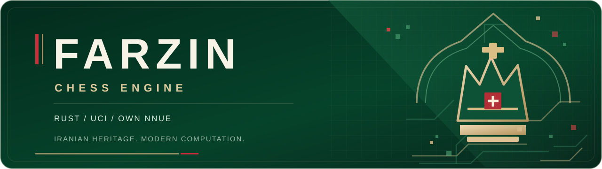
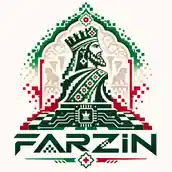
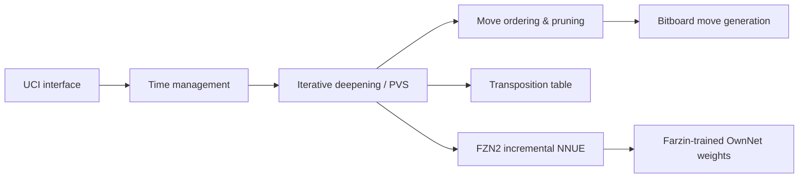

<div align="center">

<a href="https://github.com/ar-karkon/farzin">
  
</a>

<br/>

**An open-source UCI chess engine written in Rust, combining independent search engineering with a Farzin-trained neural evaluation network.**

<br/>

[](https://github.com/ar-karkon/farzin/releases/latest)
[](https://github.com/ar-karkon/farzin/actions/workflows/ci.yml)
[](LICENSE)
[](Cargo.toml)
[](#quick-start)
[](#neural-evaluation)

<br/>

[**Download**](https://github.com/ar-karkon/farzin/releases/latest) &nbsp;·&nbsp;
[**Quick start**](#quick-start) &nbsp;·&nbsp;
[**Technical design**](#under-the-hood) &nbsp;·&nbsp;
[**Benchmarks**](#measured-progress) &nbsp;·&nbsp;
[**فارسی**](#معرفی-فارسی)

</div>

---

<table>
<tr>
<td width="24%" align="center" valign="middle"></td>
<td valign="middle">

### A chess engine with its own identity

**Farzin** (فرزین) is the classical Persian name for the chess piece that became the modern queen. The engine brings that heritage into a modern, performance-oriented Rust codebase.

Built for chess-engine research, reproducible testing, and UCI-compatible play — not a GUI, chess website, or Stockfish wrapper.

**The competition edition ships with Farzin's own FZN2 NNUE weights.**

</td>
</tr>
</table>

## Why Farzin?

| | |
| :--- | :--- |
| **Independent Rust search** | Alpha-beta / PVS, iterative deepening, aspiration windows, selective pruning, late-move reductions and search-history heuristics. |
| **OwnNet neural evaluation** | Independently implemented FZN2 architecture: king-bucketed features, SCReLU, material-output buckets and incremental evaluation. |
| **Competition-ready UCI** | Standard UCI interface, configurable hash and threads, ponder support, and built-in move/time-management safeguards. |
| **Fast CPU execution** | Bitboards, transposition tables, Lazy SMP, SIMD evaluation and optimized AVX2/BMI2/PEXT release builds. |
| **Evidence-driven development** | Paired-opening matches, SPRT, fixed-node experiments, benchmark signatures and CI regression tests. |
| **Open and auditable** | Source code, network provenance, training tools, raw test reports and reproducible release scripts. |

## Download & play

**Farzin 0.5.2 OwnNet** is the licensing and packaging maintenance release;
search and FZN2-b1 weights are unchanged from 0.5.1. See the
[0.5.2 verification report](docs/release-0.5.2-report.md).

**Get the newest tested binaries from the [Releases page](https://github.com/ar-karkon/farzin/releases/latest).**

| Build | Who should choose it? |
| :--- | :--- |
| **Windows x64 · AVX2 + BMI2 / PEXT** | Recommended competition build for supported CPUs. |
| Windows x64 · AVX2 | Alternative when BMI2/PEXT performance or availability is a concern. |
| Windows x64 · POPCNT | Compatibility build for older x64 processors. |
| Linux x64 · AVX2 + BMI2 | Linux users with supported processors; build from source when needed. |

Add the executable as a **UCI engine** in a compatible chess GUI (for example Cute Chess, Arena or Banksia). The Windows builds are self-contained; no Rust or Python installation is required.

> [!IMPORTANT]
> **For engine testing / rating lists, use the release labeled OwnNet.** The default Research build is a separate edition using a publicly released Stockfish-project CC0 network for evaluation research. Verify the selected network and CPU features using `farzin --version`.

## Quick start

**Run the official OwnNet build from source:**

```bash
git clone https://github.com/ar-karkon/farzin.git
cd farzin
cargo build --release --locked --features ownnet
./target/release/farzin --version
./target/release/farzin
```

Send UCI commands to the running process:

```text
uci
isready
setoption name Hash value 64
setoption name Threads value 1
ucinewgame
position startpos
go movetime 1000
quit
```

On Windows, use the executable from [the latest release](https://github.com/ar-karkon/farzin/releases/latest) instead of compiling. Run `farzin-...exe --version` to check the embedded network and required CPU capabilities.

## Under the hood



<details>
<summary><b>Search, evaluation and engineering details</b></summary>

**Search:** alpha-beta / PVS, aspiration windows, late-move reductions, null-move pruning, ProbCut, futility and other selectivity techniques; main, continuation and correction histories; Lazy SMP with a shared transposition table. Individual research changes are tracked and tested rather than accepted on NPS alone.

**FZN2:** Farzin's independent king-aware feature representation with bucketed perspectives, quantized SCReLU-based inference, incremental evaluation and SIMD kernels. The competition model is trained by Farzin's own tooling on positions generated from Farzin's search trees.

**Training provenance:** OwnNet weights are trained by Farzin, but their training targets were generated using a Stockfish-project network published under CC0. The pretrained Stockfish weights themselves are **not embedded** in the competition binaries. See [network provenance](nets/README.md) and [release documentation](docs/RELEASE-0.5.md).

**Tooling:** [release checks](tools/release_check.py) · [arena](tools/arena.py) · [trainer](src/bin/farzin-train2.rs) · [release builds](tools/build_release.sh)

</details>

## Measured progress

The following are **local head-to-head measurements**, *not an official CCRL or TCEC rating*.

| Comparison | Test conditions | Measured Elo difference |
| :--- | :--- | ---: |
| **FZN2-b1** vs FZN2-a1, same search | 10+0.1 · 150 paired openings / 300 games | **+38.4** (95% CI +16.3 to +60.8) |
| **FZN2-b1** vs FZN2-a1, same search | 60+0.6 · 50 pairs / 100 games | **+52.5** (95% CI +30.1 to +75.3) |
| Updated search vs prior search, both with FZN2-a1 | 5+0.05 · 273 pairs / 546 games | **+22.3** (95% CI +7.4 to +37.3) |

These tests were conducted on specific CPU hardware and short controls; strength across different opponents and CCRL hardware cannot be inferred directly. Farzin's CCRL rating will only be stated here once an official listing exists.

**Methods and raw results:** [0.5.1 release test report](docs/release-0.5.1-report.md) · [search & training research](docs/v8-research-report.md) · [benchmark data](benchmarks/)

## Development & reproducibility

```bash
cargo fmt --check
cargo clippy --all-targets -- -D warnings
cargo test --locked
cargo test --locked --features ownnet
python3 -m unittest discover -s tests -p 'test_*.py'
```

For portable production packages, use `tools/build_release.sh` with its documented Rust and MinGW toolchains. The CI pipeline also tests Windows UCI behavior, release artifacts and network provenance.

- [Technical reports](docs/)
- [Benchmark datasets and match results](benchmarks/)
- [Training and testing utilities](tools/)
- [Network provenance](nets/README.md)
- [Third-party notices](THIRD_PARTY_NOTICES.md)

## معرفی فارسی

**فرزین** یک موتور مستقل شطرنج به زبان **Rust** است. نام آن از «فرزین»، نام تاریخی مهره‌ای که امروزه وزیر نامیده می‌شود، گرفته شده است. این پروژه با الهام از هویت ایرانی و با تمرکز بر قدرت جست‌وجو، ارزیابی عصبی اختصاصی و آزمون‌های قابل‌بازتولید توسعه پیدا می‌کند.

نسخه رقابتی **OwnNet** از معماری عصبی **FZN2** و وزن‌هایی که توسط ابزارهای خود فرزین آموزش دیده‌اند استفاده می‌کند. برچسب‌های آموزشی این شبکه با کمک یک شبکه منتشرشده تحت مجوز CC0 تولید شده‌اند؛ اما وزن‌های آماده آن در فایل اجرایی رقابتی وجود ندارند.

**[دریافت آخرین نسخه](https://github.com/ar-karkon/farzin/releases/latest)** · **[گزارش فنی](docs/v8-research-report.md)** · **[آموزش اجرا](#quick-start)**

## License & attribution

Farzin's original source and FZN2 network are distributed under **[GPL-3.0-only](LICENSE)**. Third-party materials retain their own licenses; research-network weights released by the Stockfish project are CC0, and applicable Caissa material is MIT. See [THIRD_PARTY_NOTICES.md](THIRD_PARTY_NOTICES.md) for details.

<div align="center">

---

**FARZIN** — *Iranian heritage. Modern computation.*

[Repository](https://github.com/ar-karkon/farzin) · [Releases](https://github.com/ar-karkon/farzin/releases) · [Issues](https://github.com/ar-karkon/farzin/issues) · [License](LICENSE)

</div>
